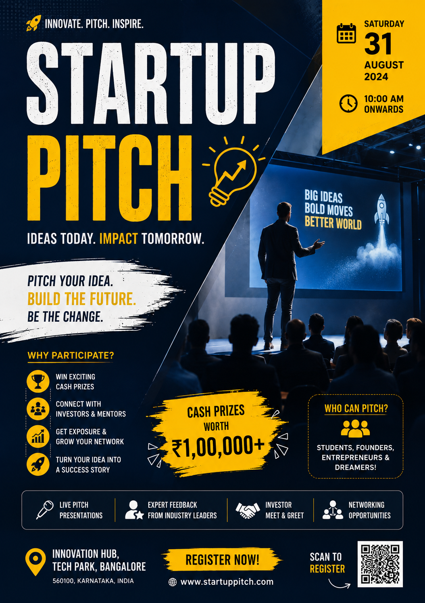

# Startup Pitch Poster Design 🚀

A bold, modern promotional poster concept for a Startup Pitch event, designed to inspire innovation, entrepreneurship, and creative ideas.

## 🎨 Project Overview

This poster showcases a startup pitch event with a strong visual hierarchy, a striking navy blue and yellow color palette, bold typography, and dynamic startup-themed visuals.

The design communicates event information clearly while highlighting cash prizes, networking opportunities, investor connections, and live pitch presentations.

## ✨ Design Highlights

- **Bold Typography:** Large, impactful headings for strong visual emphasis.
- **Color Palette:** Deep navy blue, vibrant yellow, and white.
- **Visual Hierarchy:** Clear organization of the event title, date, venue, prizes, and registration details.
- **Iconography:** Supporting icons for event benefits and activities.
- **Call to Action:** Prominent registration section to attract participants.
- **Event Information:** Dedicated sections for date, time, location, and participation benefits.

## 🖼️ Poster Preview

## 🎯 Design Goals

- Promote a startup pitch event through an engaging visual concept.
- Capture the attention of students, founders, and aspiring entrepreneurs.
- Present event details in a clear and organized layout.
- Create a professional, energetic, and innovation-focused visual identity.

## 📌 Project Type

Graphic Design | Event Poster | Promotional Design | Portfolio Project

## 👩‍🎨 Designer

**Pixel Aura Studio**

Clean, modern, purposeful design solutions.

---

*This is a sample event poster concept created for graphic design portfolio purposes. Event details and registration information are illustrative and should be verified before real-world use.*
